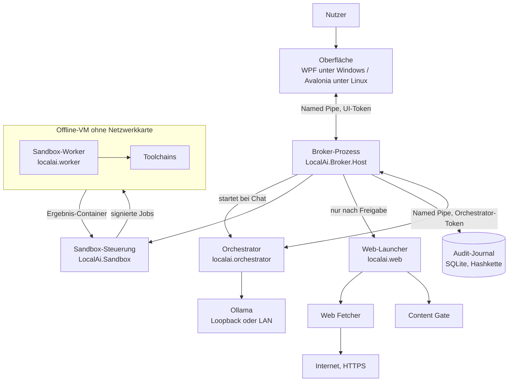
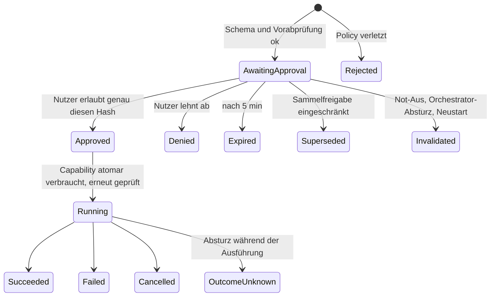
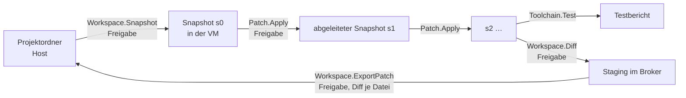

# Architektur

Dieses Kapitel beschreibt, wie das System aufgebaut ist: welche Prozesse es gibt, wer wem vertraut und wie Daten
fließen. Die verbindlichen Anforderungen und Begründungen stehen in der
[Projektspezifikation](Local-AI-Developer-Agent-Projektspezifikation.md) (§3, §4, §8, §10); hier geht es um den
tatsächlich umgesetzten Stand (M10).

## Grundprinzip

Drei Regeln bestimmen den Aufbau:

1. **Kein Werkzeugaufruf ohne Freigabe.** Auch Lesen, Suchen und Auflisten. Die Freigabe ist an den SHA-256 der
   exakten, kanonisierten Parameter gebunden und genau einmal verwendbar.
2. **Ausführung nur in der Offline-VM.** Die VM hat zu keinem Zeitpunkt eine Netzwerkkarte. Auf dem Host läuft kein
   Code aus dem Projekt.
3. **Freigabeautorität nur im C#-Broker.** Python-Prozesse (Orchestrator, Agenten, Worker, Web) dürfen vorschlagen und
   ausführen, was der Broker ihnen gibt – aber nie selbst freigeben.

Alles, was von außen kommt (Dateiinhalte, Webtext, Testausgaben, Modellantworten), gilt als *untrusted* und bleibt Text.

## Komponenten

| Komponente | Sprache / Ort | Aufgabe | Darf nicht |
|---|---|---|---|
| Oberfläche | C# – `LocalAi.Desktop` (WPF), `LocalAi.Desktop.Linux` (Avalonia), gemeinsame ViewModels in `LocalAi.Desktop.Core` | startet den Broker, zeigt Freigabekarten, Chat, Live-Aktivität, Not-Aus, Toolchains, System | Modellausgaben ausführen |
| Broker | C# – `LocalAi.Broker.Host` (Prozess), `LocalAi.Broker` (Logik) | Vorschläge prüfen, Freigaben verwalten, Capabilities einmalig verbrauchen, Dispatch, Audit-Journal, Prozessaufsicht | Freigaben ohne UI-Entscheidung erteilen |
| Verträge | JSON Schema in `contracts/`, generiert nach C# (`LocalAi.Contracts`) und Python (`localai.contracts`) | eine Quelle für alle Datenstrukturen; kanonisches JSON und Hashes in beiden Sprachen identisch | – |
| Sandbox-Steuerung | C# – `LocalAi.Sandbox` | Snapshots, Jobsignatur, VM-Lebenszyklus (Hyper-V oder QEMU), Transfer, Toolchain-Registrierung, Übernahme | Ergebnisdateien ausführen, Netzwerk einschalten |
| Orchestrator | Python – `localai.orchestrator` | fünf Rollen, Aufgabengraph (DAG), Kontextplanung, Model Gateway, Kalibrierung | Freigaben erteilen, Projektordner direkt lesen, Internet |
| Sandbox-Worker | Python – `localai.worker`, läuft **in der VM** | Jobs prüfen und ausführen: Lesen, Suchen, Patches, Repo-Index, Toolchain-Aktionen, OS-Debugging | Hostpfade erreichen, eigene Laufzeit oder Toolchains verändern |
| Web Fetcher / Content Gate | Python – `localai.web`, eigene Prozesse niedriger Integrität (Windows) bzw. bubblewrap (Linux) | genau eine freigegebene HTTPS-URL abrufen; Inhalt bereinigen und markieren | Projektordner, Ollama, Schlüssel |
| Gastdienste | Python – `localai.guest` | Einrichtung der Linux-VM (`provision`), Verbindungskanal unter QEMU (`qemulink`) | – |

Die Projektstruktur im Detail steht in der [Entwicklung](entwicklung.md#repository).

## Prozesse und Start

1. Die **Oberfläche** startet `LocalAi.Broker.Host` als Kindprozess. Der Broker liest `config/localai.json`, lädt die
   Projektdatei, öffnet das Audit-Journal (bei Manipulation startet er nicht) und gibt genau eine JSON-Zeile auf stdout
   aus: Pipe-Name, zufällige Rollen-Tokens für UI und Orchestrator, Betriebsart. Der Broker läuft, bis stdin
   geschlossen wird – er endet also mit der Oberfläche.
2. Der Broker baut im Hintergrund die **Offline-VM** auf bzw. setzt sie fort (`reuseVm`). Chat und Planung sind
   währenddessen nutzbar; Werkzeuge, die die VM brauchen, warten.
3. Die erste **Chatnachricht** startet den **Orchestrator** als Kindprozess des Brokers. Er bekommt nur den
   Orchestrator-Token (Umgebungsvariablen `LOCALAI_PIPE`, `LOCALAI_TOKEN`, `LOCALAI_RUN_ID`). Der Broker überwacht ihn
   über einen Herzschlag (`orchestrator.heartbeatTimeoutSeconds`); stürzt er ab oder hängt er, werden seine offenen
   Vorschläge ungültig (SEC-22).
4. Ein freigegebener `Web.Fetch` startet den **Web-Launcher**, der Fetcher und Content Gate als getrennte Prozesse
   ausführt.

Beim Herunterfahren beendet der Broker alle seine Kindprozesse samt deren Kindprozessen; QEMU läuft ebenfalls als
Kindprozess des Brokers.

### Rollen über Tokens

Jede Pipe-Anfrage trägt einen Token. Der Broker ordnet ihn in konstanter Zeit einer Rolle zu:

| Rolle | darf |
|---|---|
| UI | alles Lesende, **Entscheidungen** (`approvals.decide`, `approvals.narrow`), Not-Aus, Chat, Toolchain-Registrierung, VM neu aufbauen, Diagnose, Sicherung |
| Orchestrator | Vorschläge einreichen, Ergebnisse abfragen, Aktivität melden, eigenen Auftrag abholen |

Eine Entscheidung mit dem Orchestrator-Token wird abgewiesen (SEC-17). Die vollständige Methodenliste steht in der
[Entwicklung](entwicklung.md#pipe-protokoll).

## Lebenszyklus eines Werkzeugaufrufs

1. Ein Agent entscheidet sich für eine Aktion (z. B. „lies diese drei Dateien“). Der Orchestrator übersetzt sie in
   einen **Vorschlag** (`proposals.submit`) mit Werkzeug, Parametern, Zielliste und Zweck.
2. Der Broker prüft Schema, Ordnerrechte und Snapshot (`ProposalPolicy`), kanonisiert die Parameter und berechnet den
   Vorschlags-Hash. Ungültiges wird sofort abgelehnt.
3. Die Oberfläche zeigt die **Freigabekarte** mit exakten Parametern, Zielen, Nebenwirkungen und Hash. Bei
   Sammelfreigaben kann der Nutzer einzelne Ziele abwählen – das erzeugt einen neuen Vorschlag mit neuem Hash
   (`Superseded` für den alten).
4. Erlaubt der Nutzer, erzeugt der Broker eine einmalige **Capability**, gebunden an Vorschlag, Run, Sitzung, Hash,
   Snapshot und Sandbox. Beim Dispatch wird sie transaktional verbraucht – zwei gleichzeitige Dispatches führen genau
   einmal aus (SEC-03).
5. Der Broker erzeugt einen **signierten Job** und übergibt ihn der Sandbox. Der Worker prüft Signatur, Sequenz,
   Sitzung, Ablaufzeit und Vorschlags-Hash, bevor er etwas tut.
6. Das Ergebnis kommt als Container zurück, wird streng geprüft und als *untrusted* an den Orchestrator gegeben.

Es gibt keine automatischen Wiederholungen. Nach Fehler, Zeitüberschreitung oder Neustart braucht jeder Aufruf eine
neue Freigabe (SEC-12). Jeder Schritt landet im Audit-Journal.

## Sandbox

### Betriebsarten

| `sandbox.mode` | Ausführung | Einsatz |
|---|---|---|
| `test` | Testadapter zählt nur | automatische Tests |
| `none` | keine – jede Ausführung wird abgelehnt | Planung ohne Sandbox |
| `dev-local-unsafe` | Worker als normaler Prozess auf dem Host, **ohne VM**, in der Oberfläche rot; `Toolchain.*` immer gesperrt | nur Entwicklung |
| `hyperv` | Offline-VM mit Hyper-V (Windows-Host), optional zusätzlich Linux-Gast | Produktivbetrieb unter Windows |
| `qemu` | Offline-Linux-VM mit QEMU (Linux-Host) | Produktivbetrieb unter Linux |

### VM-Lebenszyklus

- **Aufbau:** Unter Hyper-V wird die Windows-VM aus dem ISO per DISM und `unattend.xml` neu installiert, die Linux-VM
  aus dem Debian-Cloud-Abbild mit cloud-init eingerichtet. Unter QEMU baut der Broker die Linux-VM ohne root
  (`qemu-img`, `mkfs.fat`, `mcopy`). Danach installiert der Gast die vom Projekt gewählten Toolchains, prüft sie mit
  einem Hallo-Welt-Beispiel und schreibt einen Bericht. Erst nach bestandenem **Selbsttest** (Netzwerkprüfungen
  scheitern, keine Netzwerkkarte, alle Toolchains ok) nimmt der Broker Jobs an.
- **Start bei Bedarf und Leerlauf (M8):** Eine VM startet erst mit dem ersten Job und fährt nach `idleMinutes` ohne Job
  herunter.
- **Wiederverwendung:** Ohne `reuseVm` wird die VM am Sitzungsende gelöscht. Mit `reuseVm` wird eine sauber beendete
  VM beim nächsten Start fortgesetzt, wenn Abbild, Einstellungen, Worker und Toolchains unverändert sind. Gesperrte
  oder abgestürzte Sitzungen werden nie wiederverwendet.
- **Sperre:** Bei Netzwerkkarte, fehlerhaftem Bericht, ausbleibender Antwort oder Not-Aus während eines Jobs wird die
  VM gesperrt bzw. ausgeschaltet. Weiter geht es nur über „VM neu aufbauen“ (bei ausbleibender Antwort optional
  „VM weiter verwenden“, ohne den Auftrag zu wiederholen).

### Mehrere Gäste (M8)

Unter Hyper-V kann es je Sitzung eine Windows- und eine Linux-VM geben. Welche VM eine Aktion ausführt:

1. `toolchainGuests` der Projektdatei (je Toolchain), sonst
2. `guestOs` der Projektdatei, sonst
3. `sandbox.defaultGuestOs` aus `config/localai.json`.

Das Toolchain-Manifest legt sein System fest (`"guest": "Linux"`); ein ausdrücklicher Widerspruch verhindert den
Start. Toolchain-Aktionen laufen in der VM ihres Systems, alles andere in der Heimat-VM des Projekts.

### Datenwege zwischen Host und VM

Es gibt kein Netzwerk, keine Freigaben, keinen Socket zum Host. Stattdessen:

| Richtung | Hyper-V | QEMU (M10) |
|---|---|---|
| Host → VM | `Copy-VMFile` legt signierte Jobpakete in den Eingang des Workers | Verbindungskanal (virtio-serial `org.localai.link`): nur Dateien in den Eingang, mit SHA-256 geprüft |
| VM → Host | Worker schreibt einen Container **ab Sektor 0 auf das Rohgerät** der Transfer-VHDX und meldet `result:<Sequenz>` über einen KVP-Wert. Der Host hängt die VHDX ab und liest die Datei mit eigenem, strengem Parser – ohne sie einzubinden | gleicher Container auf einem Transfer-Laufwerk im Rohformat, Tausch per `blockdev-reopen`; Rückmeldung als feste Zeile über den Verbindungskanal |
| Fertigmeldung | nur `result:<Zahl>` bzw. `report:0` werden akzeptiert | nur feste Zeilen (Lebenszeichen, Fortschritt, Signal, Bestätigung) |

Jedes Transfer-Laufwerk wird nur einmal benutzt und danach durch eine leere Kopie ersetzt.

### Isolation im Gast

- Jeder Job arbeitet auf einer **frischen Kopie** des Snapshots.
- **Windows-Gast:** Werkzeugprozesse laufen mit eingeschränktem Token auf niedriger Integritätsstufe in einem Job
  Object, mit leerem Benutzerprofil und fester Umgebung. Sie können Worker, Toolchains, Windows und HKLM nicht
  verändern.
- **Linux-Gast:** Werkzeugprozesse laufen als `localai-tools` ohne Zusatzgruppen, mit `no_new_privs` und eigenem,
  leerem Netzwerk-Namespace. Nach dem Job werden alle Prozesse und temporären Dateien des Benutzers entfernt.
- Prozessbäume werden nach der Zeitgrenze beendet.

## Snapshots und Übernahme

Der Projektordner auf dem Host wird nie direkt von der VM gelesen oder beschrieben.

- **Snapshot:** Der Broker liest den freigegebenen Ordner (ohne Verknüpfungen, Junctions, Hardlinks), erstellt ein
  Manifest mit Hashes und überträgt die Kopie in die VM. Die Snapshot-ID ist an den Inhalt gebunden.
- **Patches** erzeugen neue, unveränderliche Snapshots – alles oder nichts.
- **Übernahme** in den Projektordner ist ein eigener, zweistufiger Vorgang. Der Broker berechnet den Diff selbst gegen
  den *aktuellen* Projektordner, prüft vor dem Schreiben jede Datei erneut, sichert die Originale und schreibt atomar.

## Agenten und Orchestrierung

Der Orchestrator legt je Ziel einen Run mit fünf Rollen an:

| Rolle | Aufgabe |
|---|---|
| Planner | liest die Repo-Map, zerlegt das Ziel in einen Aufgabengraph mit Akzeptanzkriterien und Prüfläufen |
| Coder | erzeugt Patches für einzelne Aufgaben |
| Tester | entwirft Testfälle und Testpatches für unabhängige Teile; nicht ausgeführte Tests werden als solche gekennzeichnet |
| Debugger | analysiert echte Testfehler und schlägt minimale Korrekturen vor (höchstens `maxRepairAttempts` Runden) |
| Reviewer | prüft den finalen Diff gegen Ziel, Akzeptanzkriterien und Testbericht |

- **DAG-Scheduler** (`orchestrator/dag.py`): unabhängige Aufgaben laufen parallel, Schreibzugriffe auf dieselben Pfade
  werden serialisiert, unbekannte Schreibmengen bekommen einen exklusiven Lock.
- **Ein GPU-Slot:** Standardmäßig läuft genau eine Modellanfrage gleichzeitig, fair zwischen den Rollen verteilt.
- **Model Gateway** (`orchestrator/gateway.py`): Streaming von Ollama, Abbruch, Watchdog für ausbleibende Tokens,
  Erkennung von Wiederholungsschleifen. Kontext wird je Anfrage gesetzt – nur nach Kalibrierung.
- **Kontextaufteilung** (`orchestrator/context.py`): 12,5 % Regeln, 12,5 % Aufgabe, 44 % Evidenz, 25 % Ausgabe, 6 %
  Reserve. Regeln werden nie gekürzt; Evidenz ist als untrusted markiert und kann ihren Rahmen nicht schließen.
- **Prompts** liegen versioniert in `src/python/localai/orchestrator/prompts/*.md` (Englisch). Antworten an den Nutzer
  sind Deutsch.
- **Runjournal:** Ziel, Plan, Aufgabenstände und angewendete Patches – nie Freigaben. Damit lässt sich ein
  unterbrochener Run fortsetzen.

## Audit-Journal

`audit.db` im Datenordner ist ein SQLite-Journal mit **Hashkette**: Jeder Eintrag enthält den Hash des vorigen.
UPDATE oder DELETE auf alten Einträgen fallen beim Start und bei der Prüfung auf; ein manipuliertes Journal verhindert
den Start des Brokers. Die Prüfung umfasst auch Freigabeinvarianten (jede Ausführung hat genau eine passende
Entscheidung). Sie gilt nicht gegen einen vollständig kompromittierten Host-Administrator.

## Web

Zwei getrennte Freigaben (SEC-09):

1. **`Web.Fetch`** – genau eine `https://`-URL. Broker und Fetcher prüfen die URL und **jede** DNS-Antwort (keine
   privaten, lokalen, reservierten Adressen); die Verbindung wird an die geprüfte Adresse gebunden. Keine
   Weiterleitungen, Cookies oder Umgebungs-Proxys. Rohdaten bleiben in der Quarantäne.
2. **`Web.Content`** – genau dieser bereinigte Text an genau diesen Agenten, gebunden an seinen SHA-256.

Das Content Gate entfernt Skripte, versteckte Elemente, aktive Links und Steuerzeichen, markiert Bidi- und
unsichtbare Zeichen und meldet Stellen, die wie Anweisungen an KI-Agenten aussehen. Sanitizing ist **kein**
Vertrauensbeweis: Der Text bleibt untrusted Evidenz.

## Weiterführend

- Bedrohungsmodell und Gegenmaßnahmen: [Spezifikation §12](Local-AI-Developer-Agent-Projektspezifikation.md#12-sicherheitsregeln-und-bedrohungsmodell)
- Zuordnung Anforderung → Test: [anforderungen-tests.md](sicherheit/anforderungen-tests.md)
- Architekturentscheidungen (ADR 001–018): [Spezifikation §18](Local-AI-Developer-Agent-Projektspezifikation.md#18-architekturentscheidungen-und-offene-punkte)
