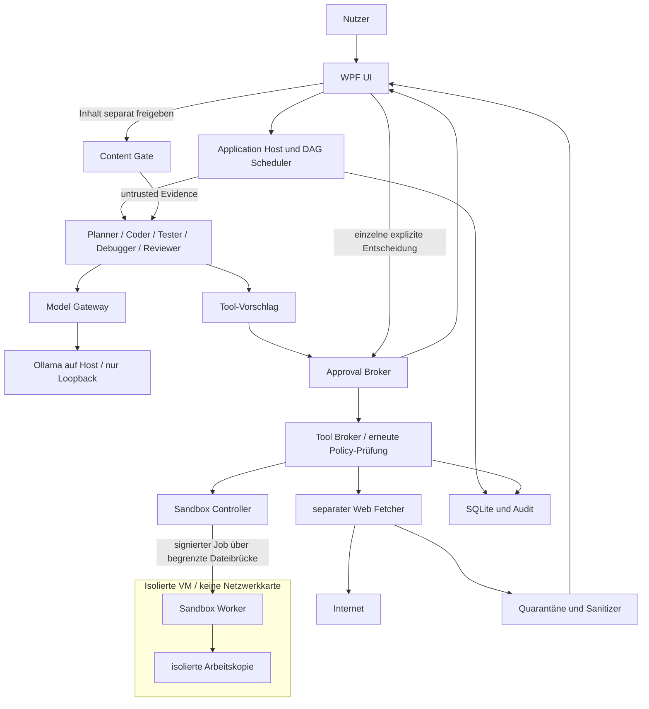
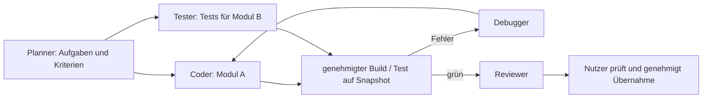
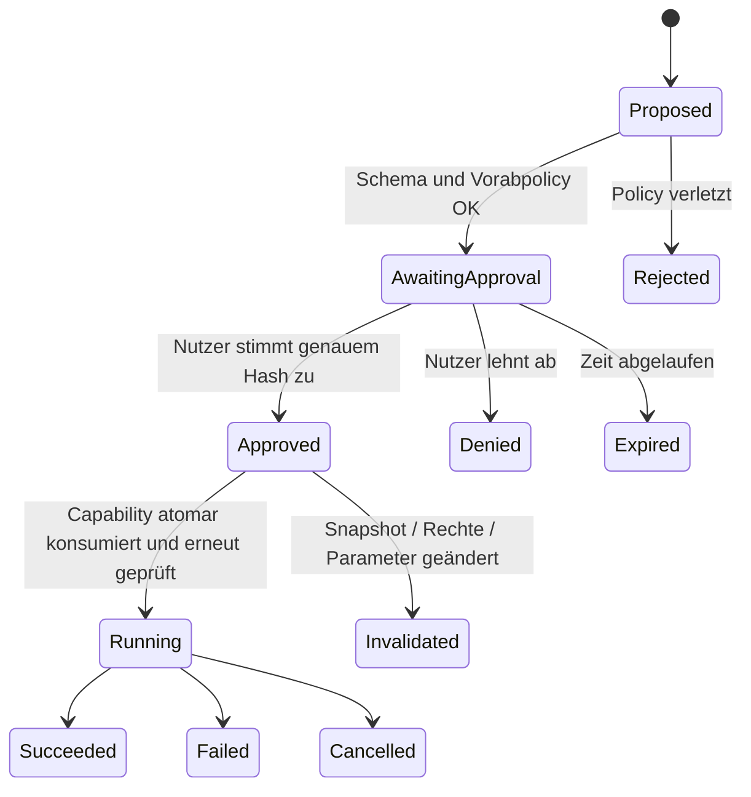
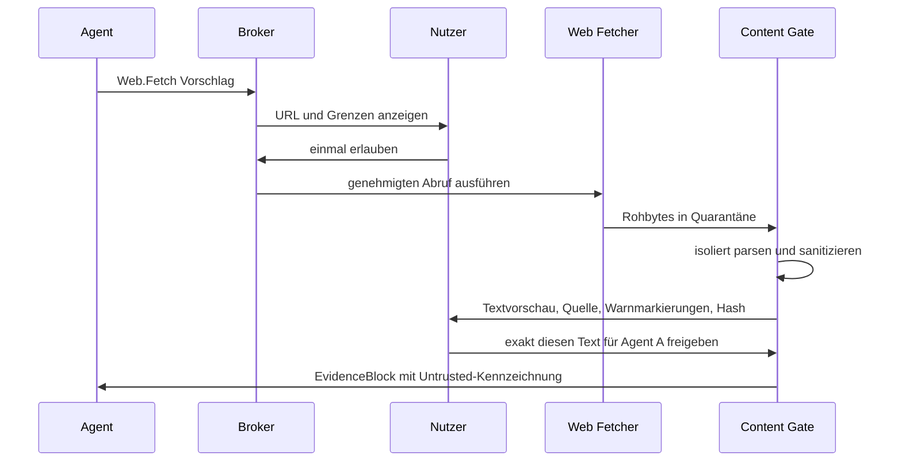

# Local AI Developer Agent – vollständige Projektspezifikation

Version 1.0 · Stand: 16.10.2026 · Status: umsetzbarer Architekturvorschlag, noch keine implementierte Software

## 1. Herkunft, Ziel und Verbindlichkeit

Grundlage ist die Unterhaltung „Projektplan KI Coding Agent“, Gesprächs-ID `6ad248ac-7528-83eb-91b7-3ed4d3c51723`, einschließlich der aktuellen Anforderungen. Die historischen Nutzerbeiträge konnten gelesen werden. Frühere Assistentenantworten liegen im verfügbaren Export ausschließlich als Inhaltsreferenzen vor und konnten nicht rekonstruiert werden. Dieses Dokument behauptet daher keine vollständige Wiederherstellung dieser Antworten. Es konsolidiert alle verfügbaren Nutzeranforderungen und ergänzt sie um ausdrücklich vorgeschlagene technische Entscheidungen.

Ziel ist ein lokaler Chatbot, der neue und bestehende Softwareprojekte planen, entwickeln, testen, debuggen und prüfen kann. Modelle laufen lokal über Ollama. Der Mensch behält die Entscheidung über jeden Tool-Aufruf und jede Übernahme externer Webinhalte.

**MUSS** ist eine verbindliche Produktanforderung. **SOLL** bezeichnet den vorgesehenen Standard. **OPTIONAL** ist eine spätere Erweiterung. Alle konkreten Bibliotheken, Zeitpläne und Ressourcenbudgets sind Vorschläge und werden durch einen Prototyp validiert.

### Verbindliche Anforderungen

| ID | Anforderung |
|---|---|
| R01 | Windows 11, NVIDIA-GPU mit 16 GB VRAM, 64 GB RAM |
| R02 | C#/.NET primär; Python optional, ohne Sonderrechte |
| R03 | Planner, Coder, Tester, Debugger und Reviewer ab dem ersten funktionalen Agentenrelease vorhanden |
| R04 | Unabhängige Aufgaben parallel; abhängige Aufgaben anhand eines Aufgabengraphen geordnet |
| R05 | Explizite, einzelne Nutzerfreigabe vor JEDEM Tool-Aufruf, auch Lesen, Suche, Statusabfrage und Test |
| R06 | Webabruf außerhalb der Ausführungssandbox; sanitisierten Inhalt vor Übergabe an Agenten separat genehmigen |
| R07 | Externe Inhalte bleiben untrusted; keine Berechtigungsänderung durch Prompt oder Modellantwort |
| R08 | Ausführungssandbox ohne Netzwerk, einschließlich Zugriff auf Host, LAN, Internet und Ollama |
| R09 | Ausschließlich explizit freigegebene Hostordner mit konkreten Rechten; keine implizite Vererbung auf andere Ordner |
| R10 | Lokale Speicherung, nachvollziehbare Ausführung, Abbruch, Wiederaufnahme und überprüfbare Änderungen |

### Abgrenzung

Das MVP bearbeitet .NET-Repositories und lokale Dateien. Es veröffentlicht, installiert oder versendet nichts automatisch. Git-Commit, Export, Paketinstallation und spätere externe Integrationen sind eigene Tools und verlangen jeweils eine Freigabe. Cloudmodelle und Telemetrie sind standardmäßig aus. Eine Modellantwort ist nie eine Sicherheitsentscheidung.

## 2. Nutzungsablauf

1. Nutzer legt Projekt an und wählt erlaubte Ordner sowie Rechte.
2. Die UI zeigt alle fünf Rollen. Der Planner erstellt aus bereits mitgeteilten Informationen einen Plan.
3. Benötigt ein Agent Repositorydaten, erzeugt er beispielsweise einen einzelnen `File.Read`-Vorschlag. Bis zur Freigabe wird nichts gelesen.
4. Nach genehmigtem Lesen entstehen ein Aufgabengraph und Änderungsvorschläge. Coder und Tester können unabhängige Module bzw. Testfälle entwerfen. Reviewer prüft abgeschlossene Diffs; Debugger analysiert vorhandene Fehlerdaten.
5. Jeder Schreib-, Build- oder Testaufruf erhält eine eigene Freigabekarte. Ein Build darf intern zahlreiche Dateien berühren; diese transitive Wirkung wird auf der Karte benannt und bleibt durch die Sandbox begrenzt.
6. Ausführung erfolgt in einer isolierten Arbeitskopie. Ergebnisse und Logs werden als untrusted Daten zurückgegeben.
7. Der Nutzer prüft Diff, Tests und Review. Die Übernahme in den ursprünglichen Projektordner ist ein eigener genehmigter Tool-Aufruf.

Freigegebene Ordner sind keine Dauerfreigabe für Tools. Ein genehmigter Plan ist keine Tool-Freigabe. Warten ohne Antwort bedeutet niemals Zustimmung.

## 3. Technologiestack und Lösungsstruktur

Vorgeschlagen: .NET 10 LTS mit festgeschriebener, unterstützter Patchversion; WPF für die Windows-Desktopoberfläche; ASP.NET Core für den lokalen Application Host; System.Text.Json für Verträge; SQLite für Metadaten; xUnit für Tests; Roslyn für C#-Analyse. Die konkrete SDK-Version wird bei Projektbeginn in `global.json` fixiert. Die Microsoft-Supporttabelle ist die maßgebliche Quelle für Laufzeitpflege [S6].

WPF hält die Anwendung Windows-nativ und weitgehend in C#. Die Sicherheitsdomäne ist unabhängig von UI, Modellanbieter und optionalem Orchestrierungsframework. Für das MVP genügt ein eigener kleiner DAG-Scheduler. Ein zusätzliches Agentenframework ist keine Voraussetzung.

```text
LocalAiDeveloper.sln
  src/
    LocalAi.Desktop/             WPF, Freigaben, Diff, Chat
    LocalAi.Application/         Anwendungsfälle, Scheduler, fünf Rollen
    LocalAi.Domain/              Zustände, Rechte, unveränderliche Verträge
    LocalAi.AppHost/             lokale authentifizierte API
    LocalAi.ModelGateway/        Ollama, Kontext- und Speicherplanung
    LocalAi.ApprovalBroker/      Entscheidungs- und Capability-Verwaltung
    LocalAi.ToolBroker/          typisierte Adapter, Policy-Prüfung
    LocalAi.SandboxController/   VM-Lebenszyklus, Job-Übergabe
    LocalAi.SandboxWorker/       isolierte Datei-/Build-/Testadapter
    LocalAi.WebFetcher/          einziger Internetabrufprozess
    LocalAi.ContentGate/         Parser, Sanitizer, Quarantäne
    LocalAi.Persistence/         SQLite, Artefakte, Audit
    LocalAi.Contracts/          versionierte DTOs
  tests/
    Unit/ Integration/ Security/ EndToEnd/ ModelEval/
  docs/ config/ tools/offline-bootstrap/
```

Python darf später als begrenzter Orchestrierungs-Client arbeiten. Er erhält nur Vorschlagsrechte gegenüber der Broker-API, keine Dateisystem-, Netzwerk- oder Ausführungsrechte zusätzlich zur jeweiligen Prozessdomäne. Ein Python-Tool läuft wie jedes andere Ausführungstool in der Sandbox.

## 4. Architektur und Vertrauensgrenzen



Die Sandbox erhält keinen HTTP-Zugang zum Host. Ollama läuft außerhalb der Sandbox. Der Host übermittelt ausschließlich freigegebene Jobdaten; die Sandbox führt keine eigenen Modellaufrufe aus. Der Web Fetcher hat weder Zugriff auf Projektordner noch auf Ollama oder Freigabeschlüssel. Sein Netzwerkzugriff wird pro genehmigter URL begrenzt.

### Komponenten und Verantwortlichkeiten

| Komponente | Verantwortlichkeit | Darf nicht |
|---|---|---|
| Desktop | Nutzeridentität, Vorschau, Entscheidung, Not-Aus | selbst Modellausgaben ausführen |
| Application Host | Aufgaben und Agentenzustände | Tool Broker umgehen |
| Model Gateway | ausschließlich lokale Inferenz, Tokenbudget | Tools aus Modellantworten ausführen |
| Approval Broker | unveränderliche Anfrage, einmalige Capability | globale Auto-Freigaben anbieten |
| Tool Broker | Schema, Rechte, Preconditions, Dispatch | freie Adapter nach Modellwunsch laden |
| Sandbox Controller | attestierte Offline-Umgebung | still Netzwerk einschalten |
| Worker | genehmigten Job in isoliertem Scope ausführen | Hostpfade außerhalb der Mounts erreichen |
| Web Fetcher | begrenzte GET-Abrufe | Skripte, Logins, Downloads ausführen |
| Content Gate | sichere Darstellung und separate Inhaltsfreigabe | Sanitizing als Vertrauensbeweis behandeln |
| Persistence | Journaling und Wiederanlauf | Freigaben nach Neustart erneut verwenden |

## 5. Fünf Agenten und Parallelität

Alle Rollen werden beim Anlegen eines Runs instanziiert. „Vorhanden“ bedeutet eigene Identität, Inbox, Zustand, Arbeitsauftrag und Ergebnisvertrag; es bedeutet nicht fünf residente Modelle oder fünf ununterbrochene Generierungen.

| Rolle | Eingang | Ergebnis | Grenzen |
|---|---|---|---|
| Planner | Nutzerziel, genehmigte Evidenz | DAG, Abhängigkeiten, Akzeptanzfälle | genehmigt keine eigenen Aktionen |
| Coder | eingegrenzte Aufgabe, Basis-Snapshot | Patch-Vorschlag, Begründung | schreibt nur über Tool Broker |
| Tester | Anforderungen, stabiler Snapshot | Testplan, Testpatch, Testbericht | kennzeichnet nicht ausgeführte Tests |
| Debugger | genehmigte Fehlerlogs, Repro | Hypothese, minimaler Fix, Regressionstest | keine unbegrenzten Reparaturschleifen |
| Reviewer | Diff, Anforderungen, Testbericht | priorisierte Befunde mit Evidenz | darf Review nicht als Nutzerfreigabe ausgeben |

DAG-Knoten enthalten Eingabe-Snapshot, Lesemenge, Schreibmenge und Abhängigkeiten. Schreibaufgaben auf denselben Pfad werden serialisiert. Unbekannte Schreibmengen erhalten einen exklusiven Workspace-Lock. Tests laufen nur auf unveränderlichen Snapshots. Eine Dateiänderung invalidiert betroffene Test- und Reviewergebnisse.

Standard: maximal zwei unabhängige Sandboxjobs, maximal ein GPU-Inferenzrequest. Während ein Test läuft, kann ein anderer Agent lokal planen oder auf der GPU generieren. Echte parallele Inferenz ist ein optionales, vermessenes Profil; keine Voraussetzung für parallele Agentenarbeit.

Scheduler: Round-Robin mit Priorität für Nutzerinteraktion und abschließende Reviews; keine starvebaren Rollen. Pro Aufgabe höchstens drei erfolglose Reparaturversuche, dann Nutzerentscheidung. Limits: 20 Modellschritte pro Aufgabe, 30 Minuten aktive Laufzeit ohne neue Nutzerinteraktion, konfigurierbar. Warten auf Freigabe zählt separat und löst keine automatische Fortsetzung aus.



## 6. Tool-Freigaben als harte Sicherheitsinvariante

### Was als Tool gilt

Jeder Agentenzugriff auf externe Zustände oder Nebenwirkungen ist ein Tool: Datei lesen/suchen/auflisten/schreiben/löschen, Repositorystatus, Build, Test, Prozess, Webabruf, Paketbeschaffung, Export, Git und externe Dienste. Auch Read-only-Aufrufe benötigen Zustimmung. Automatische Dateiwatcher dürfen keine neuen Repositoryinhalte in den Agentenkontext einspeisen.

Reine Modellinferenz auf bereits zugelassenen Eingaben, UI-Rendering, In-Memory-Scheduling und internes Speichern des Betriebszustands sind Infrastruktur, keine Agententools. Diese begrenzte Definition wird in der UI erläutert. Infrastruktur darf weder Repositoryzugriff noch Webabruf tarnen. Downloads von Modellen sowie das Öffnen/Starten einer Sandbox sind sichtbare administrative Aktionen mit expliziter Nutzerbestätigung. Das Produkt bietet keinen Modus zur automatischen Toolfreigabe.

### Freigabekarte

MUSS zeigen: Rolle und Aufgabe, Tool und Version, Zweck, exakte normalisierte Parameter, absolute Zielpfade bzw. URL, Lesemenge/Schreibmenge, ausführbare Datei samt Hash, getrennte Argumentliste, Arbeitsverzeichnis, erlaubte Umgebungsvariablen, Sandbox-ID, Basis-Snapshot, erwartete Nebenwirkungen, Zeit-/Ausgabegrenzen, Ablaufzeit und Datenabfluss. Für Patches vollständiger Diff; für Prozesse Hinweis auf transitive Ausführung durch Buildskripte oder Tests.

Nur „Diesen Aufruf einmal erlauben“ und „Ablehnen“. Änderungen durch den Nutzer erzeugen einen neuen Vorschlag und eine neue Vorschau. Keine Sammelfreigabe für spätere, noch unbekannte Aufrufe; keine Checkbox „immer erlauben“.

### Zustände und Bindung



Standardgültigkeit: fünf Minuten bis zum Start. Broker erzeugt eine kryptografisch zufällige, einmalige Capability, gebunden an Proposal-ID, Run-ID, authentifizierte Nutzersitzung, kanonischen Parameterhash, Toolversion, Policyrevision, Snapshot und Sandbox. Der Broker prüft und konsumiert sie transaktional beim Dispatch. Nur der Broker hält Signierschlüssel; Modelle und Worker besitzen keine Freigabeautorität.

Erneuter Aufruf nach Fehler, Timeout, Absturz oder verweigertem Zugriff braucht eine neue Freigabe. Keine automatischen Tool-Retries. Ein Testprozess darf innerhalb des genehmigten Aufrufs mehrere Testfälle ausführen, aber keine zusätzlichen Hosttools aufrufen. Die Genehmigung gilt für den ausgewiesenen Prozessbaum und dessen Sandboxscope, nicht für beliebige Folgeaktionen.

TOCTOU-Schutz: Für Lesen erwarteten Dateihash bzw. Snapshot binden; für Schreiben vorherigen Inhaltshash prüfen; für neue Dateien Nichtexistenz prüfen. Nach Abweichung neuer Vorschlag. Pfade vor und unmittelbar bei Zugriff anhand endgültiger Datei-Handles validieren. Reparse Points, Junctions, Symlinks, Alternate Data Streams, Gerätepfade, UNC-Pfade und Hardlinks werden im MVP abgelehnt. Ein bloßer String-Präfixvergleich genügt nicht.

Not-Aus stoppt Dispatch, invalidiert offene Capabilities und beendet aktive Prozessbäume. Bereits erfolgte externe Wirkungen lassen sich nicht pauschal zurückrollen; lokale Änderungen bleiben in der Arbeitskopie prüfbar.

## 7. Web und Schutz vor Prompt Injection

Zwei getrennte menschliche Entscheidungen sind zwingend:

1. **Fetch-Freigabe:** exakte URL, Host, Zweck, Größenlimit und Weiterleitungsregeln genehmigen.
2. **Content-Freigabe:** nach Abruf exakten sanitisierten Text samt Herkunft prüfen; erst dann diesen unveränderlichen Inhalt für benannte Empfänger freigeben.



Fetcher: HTTPS GET, keine Cookies oder Browserprofile, keine Authentifizierung, kein JavaScript, keine Formulare, keine externen Subressourcen. Standard: 2 MiB Antwort, 15 Sekunden, maximal 20.000 Zeichen nach Extraktion. Weiterleitungen werden angehalten und als neue URL separat genehmigt. Kein Hintergrund-Crawl und kein Prefetch von Links.

SSRF-Abwehr: private, Loopback-, Link-local-, Multicast-, reservierte und Metadatenadressen für IPv4/IPv6 sperren; sämtliche DNS-Antworten prüfen, Verbindung an geprüfte Zieladresse binden, TLS-Hostname prüfen, Proxy-/Umgebungsumleitungen deaktivieren. DNS-Rebinding, alternative IP-Schreibweisen und IPv4-in-IPv6 testen. Fehlende sichere Bindung bedeutet Abruch. Netzwerkausgang ist nur für diesen Fetchprozess zulässig.

Sanitizer entfernt Skripte, Styles, versteckte Elemente, Eventhandler, eingebettete Objekte, aktive Links und Steuerzeichen. Extraktion in einen inerten Plaintext-Viewer; HTML niemals direkt im privilegierten UI-WebView rendern. Links werden als Text mit Ziel angezeigt. Unicode-Bidi und unsichtbare Zeichen werden sichtbar markiert. Archive, Binärdateien und PDFs werden im MVP abgelehnt; spätere Parser laufen separat isoliert.

Inhaltsfreigabe bindet Rohhash, sanitisierten Hash, Sanitizerversion, Quell- und finale URL, Zeitpunkt, ausgewählte Textspanne, Empfängerrolle und Run. Jede nachträgliche Änderung oder erneuter Abruf benötigt neue Inhaltsfreigabe. Abgelehnte Inhalte bleiben außerhalb aller Agentenkontexte und Suchindizes.

**Sanitizing verhindert Prompt Injection nicht zuverlässig.** Auch normaler Text kann bösartige Anweisungen enthalten. Deshalb wird jeder EvidenceBlock als Datenquelle mit unveränderlichem Herkunftslabel transportiert. Er darf nicht Systemprompt, Tooldefinition, Policy, Freigabe oder Agentenrolle ersetzen. Ein Injection-Detektor liefert Hinweise, aber keine Sicherheitsgarantie. Die harten Schutzschichten bleiben Broker, Nutzerentscheidung und Sandbox.

Dasselbe gilt für README-Dateien, Kommentare, Testausgaben, Dateinamen und Antworten anderer Agenten. „Ignoriere Regeln“ in einer Datei bleibt Dateitext. Zusammenfassungen behalten die Herkunft ihrer Quellen; sie werden durch Zusammenfassung nicht trusted.

## 8. Offline-Sandbox und Ordnerrechte

### Produktionsziel

Vorgeschlagen ist eine dedizierte Hyper-V-VM ohne virtuelle Netzwerkkarte, mit vorinstalliertem SDK und eingeschränktem Workerbenutzer. Kein NAT, kein Default Switch, kein Hostloopback, keine Netzwerkfreigaben. Toolausführung auf dem Host ist verboten. Windows-Edition und Virtualisierung müssen bei Installation geprüft werden; falls die Isolation nicht bereitsteht, bleibt Ausführung gesperrt.

Die VM nutzt eine eigene virtuelle Festplatte mit dem Gastbetriebssystem. „Nur freigegebene Ordner“ bezieht sich auf Zugriff auf Hostdaten; interne Betriebssystem- und temporäre Gastdateien sind für den Betrieb erforderlich und werden separat begrenzt. Host-Benutzerprofil, SSH-Schlüssel, Browserdaten und Hostmodellverzeichnis werden niemals eingebunden.

Datenaustausch erfolgt über einen eng begrenzten, hostkontrollierten Offline-Transfer, beispielsweise geprüfte Dateien über Hyper-V-Gastdienste und dedizierte Transferdatenträger. Das ist ein zu implementierender Adapter, kein bereits vorhandener sicherer RPC-Kanal. Keine SMB-Brücke und kein TCP-Forwarding. Jobs sind signiert, sequenziert, größenbegrenzt und gegen Wiederholung geschützt. Ergebnisse gelten als untrusted; der Host führt Ergebnisdateien niemals aus.

### Rechteprofil – Beispiel

| Hostpfad | Gastbezug | Rechte | Durchsetzung |
|---|---|---|---|
| `D:\Projects\Example` | importierter Snapshot unter `C:\Work\repo` | Host: Lesen nach Einzelgenehmigung | kein direkter VM-Mount; genehmigter Snapshotimport |
| `D:\Agent\Runs\<run>\staging` | `C:\Work\repo` und Rückexport | Lesen, Erstellen, Ändern; Löschen nur explizit | Brokerrechte + getrennte Gastarbeitskopie |
| `D:\Agent\OfflinePackages` | `C:\Packages` | Lesen | read-only Transfermedium; kein Schreibrecht |
| `D:\Agent\Runs\<run>\outbox` | Ergebnisübergabe | Ergebnisdateien erstellen | eigenes Verzeichnis, Größen- und Typprüfung |
| alle anderen Hostpfade | keiner | keine | nicht eingebunden; Broker verweigert |

Ordnerfreigaben modellieren Read/List/Create/Modify/Delete/Execute getrennt, Rekursion explizit. Delete und Execute sind standardmäßig aus. Read-only-Paketcache bedeutet nicht, dass darin enthaltene Programme trusted sind. NuGet/MSBuild-Targets können beim Build Code ausführen und gehören in die VM.

Im Gast kann bösartiger Buildcode die für seinen Prozess beschreibbare Arbeitskopie verändern. Die Hostpolicy kann nicht jeden internen Dateizugriff eines beliebigen Programms einzeln kontrollieren. Deshalb erhält jeder Prozess nur den minimalen vollständigen Jobscope; strengere Rechte zwischen Jobs werden durch getrennte Benutzer/ACLs oder getrennte VM-Snapshots durchgesetzt. Nur ausdrücklich genehmigte Änderungen werden später ins Original übernommen.

Limits: 4–8 vCPUs als Startwert, 12 GiB RAM für .NET-Jobs, maximal 16 GiB bei großem Build; Prozesslaufzeit standardmäßig 120 Sekunden, Testlauf maximal 10 Minuten nach sichtbarer Konfiguration; 10 MiB Logausgabe, 2 GiB Ergebnisquota. Prozessbäume über Job Objects im Gast begrenzen; VM dient als zusätzliche Abbruchgrenze. Geräte, Clipboard, Audio, Kamera, Drucker und Host-Laufwerke nicht durchreichen.

### Windows Sandbox als Prototyp

Windows Sandbox kann für einen frühen isolierten Einzellauf verwendet werden. Die dokumentierten `.wsb`-Optionen umfassen deaktiviertes Netzwerk und read-only bzw. read/write Ordner [S5]. Sie bieten keine feingranularen Create/Modify/Delete-Rechte pro Tool. Daher ist sie kein Ersatz für Brokerprüfung und isolierte Stagingkopien.

```xml
<Configuration>
  <Networking>Disable</Networking>
  <vGPU>Disable</vGPU>
  <ClipboardRedirection>Disable</ClipboardRedirection>
  <MemoryInMB>12288</MemoryInMB>
  <MappedFolders>
    <MappedFolder>
      <HostFolder>D:\Agent\OfflinePackages</HostFolder>
      <SandboxFolder>C:\Packages</SandboxFolder>
      <ReadOnly>true</ReadOnly>
    </MappedFolder>
    <MappedFolder>
      <HostFolder>D:\Agent\Runs\demo\staging</HostFolder>
      <SandboxFolder>C:\Work</SandboxFolder>
      <ReadOnly>false</ReadOnly>
    </MappedFolder>
  </MappedFolders>
</Configuration>
```

Beispiel vor Nutzung an bestehende, ausdrücklich freigegebene Verzeichnisse anpassen. Keine automatische Ausführung durch `LogonCommand` im Beispiel. Die Konfiguration allein ist kein Nachweis für bestandene Isolationstests.

### Offline-Abhängigkeiten

SDK, Testplattform und notwendige NuGet-Pakete werden während einer separaten, nutzerbestätigten Provisionierung außerhalb der Ausführungssandbox beschafft, auf Versionen/Hashes geprüft und in ein read-only Offline-Repository übernommen. Webseitentext darf keine Pakete einschleusen. Paketdownloads sind ein eigener zukünftiger Tooltyp mit sichtbarer Provenienz.

Im Gast zeigt `NuGet.Config` ausschließlich auf die lokale Quelle, alle geerbten Quellen werden mit `<clear />` entfernt. Restore nutzt Lockfiles und Locked Mode; Build und Test nutzen `--no-restore`. Bei fehlendem Paket stoppt der Job mit einem Beschaffungsvorschlag. Die Sandbox wird niemals vorübergehend online geschaltet. Netzwerkabhängige Tests werden durch lokale In-Process-Fakes ersetzt oder sichtbar als nicht ausführbar ausgewiesen.

## 9. Ollama, Modelle, Kontexte und Ressourcen

### Konkrete Startauswahl

| Profil | Modell | Verwendung | Kontext / max. Ausgabe |
|---|---|---|---|
| Standard | `qwen2.5-coder:14b`, Q4_K_M | zunächst alle fünf Rollen über separate Prompts | 8.192 / 2.048 Token |
| Leicht | `qwen2.5-coder:7b`, Q4_K_M | schwächerer Speicherzustand, kurze Tests und Änderungen | 8.192 / 2.048 Token |
| Planung experimentell | `qwen3:8b`, Q4_K_M | Planner und Reviewer nach Vergleichstest | 8.192 / 2.048 Token einschließlich ggf. Thinking-Budget |
| Erweiterung | Standardmodell mit größerem Kontext | gezielte zusammenhängende Analyse | 16.384 / 4.096 Token, nur nach Speicherprüfung |

Die Registry nennt etwa 9,0 GB für 14B, 4,7 GB für 7B und 5,2 GB für Qwen3 8B; das sind Modelldateigrößen, keine vollständigen VRAM-Verbrauchsangaben [S1–S3]. Diese Modelle sind eine konservative Baseline, kein Anspruch auf die beste Modellqualität im Oktober 2026. Austausch wird durch lokale Evaluation entschieden. Modelltag, Digest, Quantisierung, Lizenz und Ollamaversion werden im Installationsmanifest festgeschrieben; `latest` ist unzulässig.

`qwen3-coder:30b` ist mit rund 19 GB Modelldatei kein Standard für vollständige GPU-Residenz auf 16 GB VRAM. Wenige aktive MoE-Parameter bedeuten nicht, dass nur diese Gewichte gespeichert werden. CPU-Offloading ist mit 64 GB RAM prinzipiell eine mögliche spätere Messoption, aber ohne Latenzversprechen [S7].

### Speicherplanung

Planwerte in **GiB**, keine Messwerte der konkreten GPU:

| Bereich | Standardbudget |
|---|---:|
| Windows/Display/GPU-Reserve | mindestens 2 GiB VRAM frei halten |
| Ollama Gewichte + KV + Compute | Ziel maximal 13–14 GiB VRAM gesamt |
| Windows und Hintergrundprogramme | 14 GiB RAM |
| Desktop, Host, Datenhaltung | 6 GiB RAM |
| Ollama CPU-Seite / Ladepuffer | 16 GiB RAM Reserve |
| Sandbox | 12 GiB RAM |
| verbleibender RAM-Puffer | 16 GiB RAM |

Die genaue RAM-Verteilung ist ein Admission-Budget und keine Zusicherung gleichzeitiger Belegung. Displaynutzung und Shared GPU Memory sind gesondert zu beobachten. Kein automatisches Überbuchen anhand freier Auslagerungsdatei.

KV-Speicher wächst grundsätzlich mit Kontext und parallelen Sequenzen. Näherung für konventionelle Attention: `2 × Layer × KV-Heads × Head-Dimension × Token × Byte-pro-Element`; Quantisierungsmetadaten, Compute-Puffer und Modellspezifika kommen hinzu. Aus Dateigröße allein lässt sich der maximale Kontext nicht seriös berechnen.

Startwerte für den Ollama-Dienst, nach Versionsprüfung und Neustart:

```text
OLLAMA_HOST=127.0.0.1:11434
OLLAMA_MAX_LOADED_MODELS=1
OLLAMA_NUM_PARALLEL=1
OLLAMA_CONTEXT_LENGTH=8192
OLLAMA_FLASH_ATTENTION=1
OLLAMA_KV_CACHE_TYPE=q8_0
OLLAMA_NO_CLOUD=1
```

Die Ollama-FAQ beschreibt Parallelität und Cachequantisierung; deren Unterstützung muss auf installierter Version und GPU geprüft werden [S4]. Wenn q8_0 oder Flash Attention nicht funktioniert, kontrolliert auf f16 und kleineren Kontext wechseln, nicht still Speichergrenzen erhöhen. 14B und 8B werden im Standard nicht gleichzeitig geladen. Modellwechsel werden gruppiert, ohne Rollen dauerhaft zu benachteiligen.

**Kontextaufteilung bei 8.192 Token:** 1.024 System-/Rollenregeln, 1.024 Aufgabe und Kurzverlauf, 3.584 genehmigte Code-/Logevidenz, 2.048 Ausgabe, 512 Sicherheitsreserve. Alle Kategorien zählen zusammen. Tokenzählung mit passendem Tokenizer; falls nicht verfügbar konservative Schätzung und zusätzliche Reserve. Kein stilles Abschneiden von Regeln. Große Dateien werden nach ausdrücklicher Lesefreigabe abschnittsweise verarbeitet. Kein automatisches Repositoryembedding im MVP.

### Kalibrierung vor Produktivbetrieb

1. Modellversion und NVIDIA-Treiber dokumentieren; andere GPU-Last erfassen.
2. 7B und 14B jeweils mit 4K und 8K Kontext, einem Request, identischen C#-Aufgaben messen.
3. VRAM-Peak, RAM-Peak, CPU-Offload, Prompt- und Generierungsgeschwindigkeit sowie Zeit bis zur ersten Antwort erfassen. `ollama ps` und GPU-Monitoring werden im Produkt als administrative Diagnose sichtbar gestartet; agentenseitige Statusabfragen bleiben genehmigungspflichtige Tools.
4. 14B/8K freigeben, wenn mindestens 2 GiB VRAM Reserve verbleiben und zehn aufeinanderfolgende Läufe ohne OOM funktionieren. Andernfalls 7B/8K oder 14B/4K.
5. 16K nur aktivieren, wenn die gleiche Reserve und Stabilität gemessen wurden. Zwei Inferenzslots nur mit eigenem 7B-Benchmark; Standard bleibt einer.

Performanceziel für interaktive Antworten: erste Ausgabe nach warmem Laden möglichst innerhalb von 10 Sekunden; dies ist ein zu messendes Ziel, keine Hardwaregarantie. Qualität und sichere Ausführung haben Vorrang vor Tokenrate.

## 10. Domänen-, API- und Persistenzmodelle

### Zentrale Verträge (C#-Skizze)

```csharp
public enum AgentRole { Planner, Coder, Tester, Debugger, Reviewer }
public enum ApprovalState { Pending, Approved, Denied, Expired, Invalidated }
[Flags]
public enum FolderRight { None=0, List=1, Read=2, Create=4,
    Modify=8, Delete=16, Execute=32 }

public sealed record FolderGrant(Guid Id, string CanonicalRoot,
    FolderRight Rights, bool Recursive, long PolicyRevision);

public sealed record ToolProposal(Guid Id, Guid RunId, Guid TaskId,
    AgentRole Agent, string Tool, string ToolVersion,
    string CanonicalArgumentsJson, string ArgumentsSha256,
    string SnapshotId, long PolicyRevision, string SandboxId,
    DateTimeOffset ExpiresAt);

public sealed record UserDecision(Guid ProposalId, string ProposalSha256,
    ApprovalState Decision, string UserSessionId, DateTimeOffset At);

public sealed record EvidenceBlock(Guid Id, string Kind, string Source,
    string ContentSha256, string Text, bool Untrusted,
    Guid? ContentApprovalId, string[] DerivedFrom);

public sealed record ToolResult(Guid InvocationId, Guid ProposalId,
    string Status, int? ExitCode, string SnapshotId,
    string[] ArtifactIds, string OutputSha256, bool Truncated);
```

Weitere Entitäten: Project, Run, AgentInstance, TaskNode, TaskDependency, Snapshot, Patch, Invocation, ApprovalCapability, WebCapture, ContentDecision, Artifact, AuditEvent und ModelProfile. IDs sind UUIDs; Zeitstempel UTC mit UI-Anzeige in Nutzerzeitzone; Hashes SHA-256; DTOs besitzen `schemaVersion`. Zustände werden durch den Server validiert, niemals durch frei gelieferten Clienttext gesetzt.

### API-Vorschlag

Lokaler Host ausschließlich Loopback mit per Sitzung erzeugtem Token; keine CORS-Freigabe. Desktop nutzt vorzugsweise authentifizierte Named Pipes. Bei HTTP: Host-/Origin-Prüfung, Anti-CSRF für Browserzugriffe, keine Credentials in Logs. Agenten und optionales Python erhalten getrennte, eingeschränkte Identitäten. Nur der UI-Entscheidungskanal darf freigeben.

| Methode / Route | Bedeutung | Zugriff |
|---|---|---|
| `POST /v1/projects` | Projektmetadaten anlegen | UI |
| `PUT /v1/projects/{id}/folder-grants` | explizite Ordnerrechte ändern | UI; invalidiert betroffene Vorschläge |
| `POST /v1/runs` | Run mit fünf Rollen anlegen | UI |
| `POST /v1/tool-proposals` | unveränderlichen Vorschlag einreichen | Agent |
| `GET /v1/approvals/pending` | UI-Freigabequeue | UI |
| `POST /v1/approvals/{id}/decision` | konkrete Entscheidung mit Hash | ausschließlich UI |
| `POST /v1/content/{id}/decision` | sanitisierten Inhalt zulassen/ablehnen | ausschließlich UI |
| `GET /v1/runs/{id}/events` | sequenzierter Eventstream | UI |
| `POST /v1/runs/{id}/cancel` | Dispatch stoppen und aktive Jobs abbrechen | UI |
| `POST /v1/runs/{id}/resume` | sicheren Zustand wieder aufnehmen | UI; keine alten Freigaben |

Es gibt keine öffentlich erreichbare `execute(command)`-Route. Dispatch erfolgt brokerintern. HTTP 409 bei Snapshot-/Hashkonflikt, 403 bei Policyverstoß, 410 bei abgelaufener Freigabe, 422 bei ungültigem Schema, 429 bei Ressourcenlimit. API-Idempotenz verhindert doppelte Vorschläge und Entscheidungen; sie wiederholt niemals eine Ausführung.

### Toolkatalog im MVP

| Tool | Eingabe | Grenze |
|---|---|---|
| `File.List` | grantId, relativer Pfad, Tiefe | keine Inhalte, Anzahl begrenzt |
| `File.Read` | Pfad, erwarteter Hash, Zeilenbereich | z. B. 256 KiB |
| `File.Search` | genehmigte Pfade, Suchtext | keine globale Laufwerkssuche |
| `Patch.Apply` | Basis-Snapshot, vollständiger Patch | nur isolierte Arbeitskopie |
| `DotNet.RestoreOffline` | Solution, Lockfile | nur lokale Quelle |
| `DotNet.Build` | Solution, Konfiguration | festes dotnet-Binary, kein Shellstring |
| `DotNet.Test` | Projekt, Filter, Timeout | offline, stabiler Snapshot |
| `Web.Fetch` | exakte HTTPS-URL | Quarantäne; keine direkte Agentenrückgabe |
| `Workspace.ExportPatch` | Diff, Zielgrant, Vorher-Hashes | explizite Übernahme |

Ein generisches Shelltool ist kein MVP-Bestandteil. Auch typisierte Buildtools können über MSBuild-Targets beliebigen Gastcode starten; deshalb werden sie nicht als harmlos eingestuft. Argumente mit `ProcessStartInfo.ArgumentList`, feste Binarypfade und minimale Umgebung verhindern zusätzliche Shellinterpretation, ersetzen aber keine VM-Isolation.

### Datenhaltung

SQLite speichert Beziehungen und Zustände; große Texte und Artefakte liegen content-addressed außerhalb von Projektordnern. Transaktional: Approvalverbrauch + Invocationanlage + Dispatch-Outbox. Der Dispatcher verarbeitet jeden Eintrag höchstens einmal; nach unklarem Absturzstatus keine erneute Ausführung, sondern Zustand „OutcomeUnknown“ und Nutzerprüfung.

Audit enthält Event-ID, Sequenz, Run, Agent, Tool-/Parameterhash, Entscheidung, Nutzeridentität, Policyrevision, Start/Ende und Ergebnis. Hashverkettung erkennt nachträgliche Änderungen nur zusammen mit einem getrennt geschützten Checkpoint; sie schützt nicht gegen einen vollständig kompromittierten Hostadministrator. Schlüssel über Windows-Datenschutzmechanismen und Benutzer-ACLs schützen. Geheimnisse redigieren, Rohwebinhalte nicht unbeschränkt loggen.

Standardaufbewahrung als Vorschlag: Metadaten 90 Tage, Rohwebquarantäne 7 Tage, große Logs 30 Tage; Nutzer kann exportieren und löschen. Löschung ist eine sichtbare administrative Aktion. Projektcode verlässt den Host nicht über den Web Fetcher.

## 11. UI-Mockup und Interaktionen

```text
+----------------------------------------------------------------------------------+
| Local AI Developer | Projekt: Example | OFFLINE-SANDBOX BESTÄTIGT | [NOT-AUS]        |
+-------------------+-------------------------------------+--------------------------+
| AGENTEN           | CHAT UND PLAN                       | FREIGABEN (2)            |
| Planner   bereit  | Du: Ergänze CSV-Import.              | Coder · File.Read        |
| Coder     wartet |                                     | src/Importer.cs          |
| Tester    aktiv  | Plan:                               | Zeilen 1–160 · nur Lesen |
| Debugger  bereit | 1. Schnittstelle prüfen              | Snapshot a81f...         |
| Reviewer  bereit | 2. Parser + Grenzfalltests           | [Vorschau]               |
|                   | 3. Build, Review, Übernahme          | [Einmal erlauben]        |
| GPU: 1 Slot       |                                     | [Ablehnen]               |
| Kontext: 8K       | Tester entwirft unabhängige Fälle.   |                          |
+-------------------+-------------------------------------+--------------------------+
| [Diff] [Tests] [Audit] [Ordnerrechte] [Webquarantäne] [Modelle & Speicher]           |
| Tests: noch nicht ausgeführt | Originalprojekt: Übernahme ausstehend               |
+----------------------------------------------------------------------------------+
```

Webfreigabe zeigt Quelle, Abrufzeit, sichtbare Textgrenzen, markierte verdächtige Passagen und Empfänger. Buttons: „Diesen Text an Coder übergeben“ / „Ablehnen“. Kein aktives HTML, kein automatisches Öffnen enthaltener Links.

Freigabevorschau darf Tooltexte nicht als UI-Anweisung rendern. Exakte Pfade und Argumente werden kopierbar angezeigt. Fokus liegt standardmäßig auf Ablehnen oder einem neutralen Element; Enter genehmigt nicht versehentlich. Vollständige Tastaturbedienung, Screenreader-Beschriftung, ausreichender Kontrast und Statusanzeige ohne reine Farbcodierung sind Abnahmekriterien. Während einer Freigabe bleibt der übrige Run sichtbar.

## 12. Sicherheitsregeln und Bedrohungsmodell

Geschützt werden Hostdateien, Geheimnisse, Netzwerkgrenzen, Nutzerentscheidungen, Originalrepository und Auditintegrität. Angreiferquellen sind Webtext, Repositorycode, Buildtargets, Pakete, Modellantworten und manipulierte Workerresultate. Ein kompromittierter Windows-Kernel oder Hostadministrator liegt außerhalb der zugesicherten Schutzgrenze.

| Angriff | Gegenmaßnahme | verbleibende Grenze |
|---|---|---|
| Prompt Injection aus Web/README | Herkunftslabel, getrennte Rollen, Broker, einzelne Freigabe | Nutzer kann schädlichen Vorschlag dennoch genehmigen |
| Toolargument nach Freigabe geändert | unveränderlicher Hash, atomarer Consume | Hostkompromittierung außerhalb Scope |
| Pfadausbruch / Junction-Race | Handleprüfung, Snapshot, Reparse-Verbot, VM | Implementierung muss adversarial getestet werden |
| Exfiltration durch Tests | VM ohne NIC, keine Geheimnisse, begrenzte Mounts | Ausgabe kann genehmigte Daten enthalten; Export sichtbar |
| SSRF / DNS-Rebinding | geprüfte Ziel-IP-Bindung, Sperrbereiche | Fetcher darf nur freigegebene öffentliche Ziele erreichen |
| Bösartige Buildtargets | keine Hostausführung, Quoten, Gastidentität | beschreibbare Gastarbeitskopie bleibt angreifbar |
| Freigabereplay / Doppelklick | einmalige Capability, Transaktion, Nonce | kein automatischer Retry |
| Gefälschtes Testergebnis | Resultatlabel, reproduzierbarer Snapshot, eigene Auswertung | Tests sind Evidenz, kein Beweis allgemeiner Korrektheit |
| Denial of Service | Token-, Zeit-, Speicher-, Prozess- und Disklimits | Nutzer muss bei Limits umplanen |

Weitere Invarianten: deny by default; keine versteckten Netzwerkrückfälle; kein `eval` auf Modelltext; kein selbsttätiges Pluginladen; keine Richtlinienänderung durch Agenten; keine Weitergabe von Freigabetokens an Prompts; keine unkontrollierte Vererbung von Hostumgebung und Credentials. Sicherheitskonfiguration ist gegenüber Agenten read-only.

## 13. Installation und reproduzierbarer Start

### Voraussetzungen

Windows-Edition mit unterstützter VM-Isolation, aktivierte Hardwarevirtualisierung, ausreichend freier SSD-Speicher (Planwert 100 GiB für Modelle, VM, SDK, Pakete und Arbeitskopien), NVIDIA-Treiber, .NET-10-SDK und Ollama. Versionsstände vor Download anhand offizieller Quellen prüfen. Installation und notwendige Administratoraktionen erfolgen bewusst durch den Nutzer; Agenten erhalten keine Administratorrechte.

### Reihenfolge

1. Treiber und Virtualisierung prüfen; sichere Baseline des Hosts erstellen.
2. .NET-SDK und Ollama installieren; Versionen, Installerhashes und Quellen protokollieren.
3. Modelle bewusst herunterladen; keine Cloudtags wählen:

```powershell
ollama pull qwen2.5-coder:14b
ollama pull qwen2.5-coder:7b
# Optional nach Baseline-Evaluation:
ollama pull qwen3:8b
```

4. Ollama-Startkonfiguration aus Abschnitt 9 anwenden und Dienst neu starten. Bindung ausschließlich an Loopback prüfen; Cloud-/Telemetrieoptionen versionsbezogen prüfen und deaktivieren.
5. Offline-VM mit SDK, Testplattform und NuGet-Cache vorbereiten; danach NIC vollständig entfernen. Sauberen Ausgangssnapshot erstellen.
6. Hostordner für Staging, Pakete, Artefakte und Audit mit getrennten ACLs anlegen. Noch keinen Zugriff auf Originalprojekte vergeben.
7. Anwendung aus künftig signiertem Release installieren oder nach Implementierung aus dem Repository bauen. Dieses Dokument selbst enthält noch keinen lauffähigen Installer oder Quellcode.
8. Beim ersten Start Nutzeridentität, Rechte und Ressourcenprofil festlegen. Fünf Rollen müssen sichtbar sein, auch wenn alle zunächst „bereit“ anzeigen.
9. Sicherheitsselbsttest ausführen: kein Tool ohne Entscheidung; kein Netzwerk aus VM; kein Zugriff außerhalb genehmigter Ordner. Bei Fehler Ausführung sperren.
10. Modellkalibrierung aus Abschnitt 9 und Demo aus Abschnitt 16 durchführen; Manifest speichern.

Beispiel der späteren lokalen Paketkonfiguration:

```xml
<configuration>
  <packageSources>
    <clear />
    <add key="offline" value="C:\Packages" />
  </packageSources>
</configuration>
```

Die Erstbeschaffung des Offlinecaches geschieht vor dem Offlinebetrieb in einem getrennten Provisionierungsschritt. Fehlende Pakete sind ein erwarteter, sichtbarer Fehlerzustand.

## 14. Priorisiertes Backlog und Roadmap

Reihenfolge ist verbindlicher als die grobe Schätzung. Aufwand als Personentage für eine erfahrene Entwicklerin bzw. einen erfahrenen Entwickler, ohne Garantie und ohne Wartezeiten; Sicherheitsreview kann zusätzlichen Aufwand verursachen.

| ID | Priorität | Arbeitspaket | Abhängigkeit | Aufwand | Fertig, wenn |
|---|---|---|---|---:|---|
| B01 | P0 | Domainverträge, Bedrohungsmodell, Sicherheitsinvarianten | – | 2–3 | Anforderungen auf Tests abgebildet |
| B02 | P0 | Approval Broker, atomare Capabilities, Audit | B01 | 4–6 | Read ohne Freigabe unmöglich; Replaytests grün |
| B03 | P0 | UI mit exakter Vorschau und Einzelentscheidung | B02 | 3–5 | Hash und Pfad sichtbar; kein Autoapprove |
| B04 | P0 | Offline-VM und Job-/Resultatbrücke | B01 | 5–8 | NIC entfernt, Hostausbruchtests grün |
| B05 | P0 | Rechteprüfung, Snapshots, File.Read | B02–B04 | 4–6 | Pfad-/TOCTOU-Tests grün |
| B06 | P0 | Ollama-Gateway, Budgets und Kalibrierung | B01 | 2–4 | lokales Modell, harter Kontext-/Requestlimit |
| B07 | P0 | fünf Rollen und DAG-Scheduler | B05–B06 | 4–6 | alle Rollen aktivierbar; unabhängige Jobs parallel |
| B08 | P0 | Patch.Apply, Offline-Restore, Build, Test | B04–B07 | 4–7 | E2E auf isoliertem Snapshot |
| B09 | P0 | Web Fetcher, SSRF-Schutz, Content Gate | B02–B03 | 5–8 | kein Inhalt vor zweiter Entscheidung |
| B10 | P0 | Diffübernahme, Abbruch und Wiederanlauf | B08 | 3–5 | Original nur nach separater Freigabe geändert |
| B11 | P0 | Sicherheits-/E2E-Abnahme, Dokumentation | B01–B10 | 5–8 | alle Musskriterien nachgewiesen |
| B12 | P1 | große Repositories, inkrementelle Suche | B11 | 3–6 | begrenzte, genehmigte Indexierung |
| B13 | P1 | Modellvergleich und 16K-/Dualslotprofil | B11 | 2–4 | gemessener Nutzen ohne Sicherheitsregression |
| B14 | P1 | Gittools, kontrollierte Paketbeschaffung | B11 | 4–7 | eigene Vorschau und Freigabe je Aktion |
| B15 | P2 | optionale Python-Orchestrierung | B11 | 3–5 | gleicher Broker, keine Umgehung |

Geplante Etappen: Woche 1–2 Verträge und Freigabedurchstich; Woche 3–4 Offline-VM und Dateisicherheit; Woche 5–6 fünf Rollen und Code-/Testzyklus; Woche 7–8 Webgate und Übernahme; anschließend Härtung und Pilot. Eine Einzelperson sollte eher mit 9–15 Wochen rechnen; Parallelentwicklung und Umfang beeinflussen das stark. Alle fünf Rollen werden gemeinsam mit B07 integriert, nicht als spätere funktionale Erweiterung.

### Nächster konkreter Implementierungsschritt

Ein Sicherheitsdurchstich mit **einem einzigen Tool `File.Read`**, Fake-Modell und echtem Approval Broker:

1. Solution und Domain-/Contracts-/ApprovalBroker-/Desktop-/Testprojekte anlegen.
2. Unveränderliches Proposal mit Pfad, Hash, Zeilenbereich, Policyrevision und Ablaufzeit erstellen.
3. In der UI den exakten Vorschlag anzeigen; Worker zählt Ausführungen zunächst nur in einem Testadapter.
4. Nach einmaliger Entscheidung den Broker transaktional konsumieren lassen.
5. Folgende Fälle müssen vor echter Dateiausführung grün sein: keine Entscheidung = null Aufrufe; Ablehnung = null; Parameteränderung = null; Replay = null zusätzliche; zwei gleichzeitige Dispatches = genau einer; Neustart = alte Freigabe ungültig.
6. Danach echten Readadapter ausschließlich über die Offline-Sandbox anbinden. Erst anschließend Modelle mit Toolvorschlägen verbinden.

Dieser Schritt verhindert, dass spätere Agentenfunktionen auf einer lediglich promptbasierten Freigabelogik aufbauen.

## 15. Teststrategie und Nachweise

### Testebenen

- Unit: kanonisches JSON, Hashbindung, Rechteberechnung, DAG, Zustandswechsel, Tokenbudget, Sanitizerausgabe.
- Integration: SQLite-Transaktion, Broker/Worker-Verträge, Ablaufzeiten, Named-Pipe-Identität, Offlinepakete, Ergebnisquarantäne.
- Security: manipulierte Vorschläge, Race Conditions, DNS-Rebinding, Pfadvarianten, Workerresultate, Prompt Injection und Netzwerkausbruch.
- E2E: Nutzerauftrag → fünf Rollen → separate Freigaben → Patch → Offlinebuild → Tests → Review → genehmigte Übernahme.
- Modellevaluation: festes C#-Aufgabenset, kompilierbare Patches, Regressionsquote, Toolschema-Konformität und Umgang mit untrusted Inhalten. Modellqualität und Brokerisolation getrennt bewerten.

### Verbindliche Prüffälle

| Test | Angriff / Szenario | Erwartung |
|---|---|---|
| SEC-01 | Agent fordert File.Read ohne Entscheidung | Worker erhält keinen Job |
| SEC-02 | Freigabe für A, Argument wird zu B | Hashfehler, keine Ausführung |
| SEC-03 | zwei Dispatcher / wiederholte Capability | exakt eine Invocation |
| SEC-04 | Datei nach Vorschau verändert | Konflikt, neue Freigabe |
| SEC-05 | `..`, Junction, ADS, UNC, Gerätepfad | verweigert |
| SEC-06 | HTTP/HTTPS/DNS/IPv6 aus Gast zu Host/LAN/Internet | alle scheitern; fehlende NIC bestätigt |
| SEC-07 | Build versucht Browserprofil/SSH-Key zu lesen | Daten nicht vorhanden/zugänglich |
| SEC-08 | Webtext fordert Freigaben oder Dateiexport | nur Text; keine Rechteänderung |
| SEC-09 | Fetch genehmigt, Content nicht genehmigt | keine Bytes im Agentenkontext |
| SEC-10 | Text nach Content-Freigabe verändert | Hashfehler, erneute Prüfung |
| SEC-11 | öffentliche URL lenkt auf private IP um | Redirect stoppt; private Ziele gesperrt |
| SEC-12 | Timeouts oder Hostabsturz während Tool | kein automatischer Retry |
| SEC-13 | bösartiges NuGet-Target startet Gastprozess | nur genehmigter VM-Scope; kein Netz/Hostzugriff |
| SEC-14 | Log enthält HTML/ANSI/Bidi/Anweisung | inerte, begrenzte Darstellung |
| SEC-15 | Not-Aus bei laufendem Test | Dispatch gesperrt, Prozessbaum beendet |
| SEC-16 | Standardmodell zehnmal mit Zielkontext | kein OOM, Reserven dokumentiert |
| SEC-17 | Agent ruft UI-Decision-Endpunkt auf | Authentifizierung/Autorisierung verweigert |

Netzwerkisolation wird durch Konfigurationsinspektion und aktive Probes nachgewiesen; ein einzelner fehlgeschlagener Ping genügt nicht. Freigabeinvarianten werden zusätzlich mit konkurrierenden und propertybasierten Tests geprüft. Alle Sicherheitsprüfungen laufen mit Fake-Modellen deterministisch; reale Modelle ergänzen adversariale Fälle.

## 16. Acceptance Criteria und Definition of Done

| Kriterium | Abnahmeevidenz |
|---|---|
| AC01 – R01/R02 | Installation auf Windows-11-Zielhardware; Hauptkomponenten C#; Manifest mit Versionen |
| AC02 – R03/R04 | alle fünf Rollen ab Runstart sichtbar; zwei unabhängige Aufgaben überlappen zeitlich; konfligierende Writes serialisiert |
| AC03 – R05 | jeder Agententoolaufruf besitzt genau eine vorherige explizite Entscheidung mit identischem Hash; SEC-01–04 und 12/17 grün |
| AC04 – R06 | Webfetch und Inhaltsübergabe als getrennte Entscheidungen; abgelehnter Inhalt nie im Kontext |
| AC05 – R07 | Injection-Testkorpus kann keine Policies oder Freigaben verändern; untrusted Herkunft bleibt erhalten |
| AC06 – R08 | VM ohne NIC, alle Netzwerkprobes negativ; keine Ollamaverbindung aus Gast |
| AC07 – R09 | alle Hostpfade außerhalb expliziter Grants unerreichbar; Pfadausbruchtests grün |
| AC08 – R10 | Crash-Recovery ohne doppelte Ausführung; Audit, Not-Aus und Diffübernahme demonstriert |
| AC09 – Hardware | Standardprofil nach Kalibrierung ohne OOM; Kontext- und Speichermessungen gespeichert |
| AC10 – Nutzbarkeit | Entscheidungen per Tastatur/Screenreader möglich; exakte Parameter sichtbar; keine implizite Zustimmung |

Demo: Ein kleines .NET-Projekt erhält einen CSV-Parser mit Unicode-, Leerwert- und Fehlerfalltests. Planner zerlegt die Aufgabe; Coder und Tester arbeiten auf unabhängigen Teilen. Ein absichtlich fehlgeschlagener Test aktiviert Debugger; Reviewer prüft den finalen Diff. Jeder tatsächlich ausgeführte Toolaufruf wird separat genehmigt. Eine Dokumentationsseite wird erst nach Fetch- und Inhaltsfreigabe verwendet. Ein absichtlicher Netzversuch des Testcodes scheitert. Zum Schluss wird der geprüfte Patch nach eigener Freigabe ins Original übernommen.

Definition of Done: Code gebaut, relevante Tests grün, Musskriterien belegt, bekannte Einschränkungen dokumentiert, Offlineinstallationsmanifest vollständig, Runbook erprobt und keine offenen kritischen Sicherheitsbefunde. „Nicht ausgeführt“ darf niemals als „bestanden“ erscheinen. Kein automatischer Commit oder Publish als Teil der Abnahme.

## 17. Runbook

| Situation | Vorgehen |
|---|---|
| Normaler Start | Versionsmanifest und VM-Isolation prüfen; Projektrechte anzeigen; Run mit fünf Rollen starten |
| Freigabe wartet | Parameter/Diff prüfen und einzeln entscheiden; keine automatische Fortsetzung |
| OOM / GPU stark belegt | laufende Generierung abbrechen; Modell entladen; auf 7B oder 4K reduzieren; neue Messung; keine Toolwiederholung ohne Freigabe |
| Modell hängt | Inferenzrequest abbrechen, Queue erhalten; keine automatisch erzeugten Folgeaktionen ausführen |
| Offlinepaket fehlt | Job stoppen; Paket und Version als Beschaffungsvorschlag anzeigen; außerhalb VM provisionieren und erneut prüfen |
| Netzwerkisolation unklar | sämtliche Ausführung sperren; VM verwerfen und aus geprüfter Offlinebasis neu erzeugen |
| Inhalt verdächtig | Inhalt ablehnen, Capture-ID protokollieren; bereits abgeleitete Kontexte invalidieren und aus sauberer Evidenz neu aufbauen |
| Freigabe abgelaufen | neuen unveränderten oder aktualisierten Vorschlag anzeigen; keine Verlängerung ohne Entscheidung |
| Snapshotkonflikt | neue Basis lesen lassen, Diff neu erzeugen und erneut genehmigen |
| Not-Aus | Queue stoppen, Capabilities invalidieren, Prozessbäume/VM beenden; Staging zur Prüfung erhalten |
| Neustart nach Absturz | Journal lesen; laufende Jobs als unklar markieren; nie automatisch erneut ausführen; Original und Staging vergleichen |
| Backup / Restore | SQLite konsistent sichern, Artefaktmanifest und Policy exportieren; Freigabecapabilities nicht wiederherstellen |
| Update | neue Version in separater Umgebung prüfen; Sicherheitsregressionen und Kalibrierung wiederholen; Manifest aktualisieren |

Diagnosepaket enthält Versionen, anonymisierte Zustände, Event-IDs, Speicherstatistiken und Hashes. Code, Rohwebinhalte und Geheimnisse werden nur nach sichtbarer Auswahl exportiert. Diagnoseexport ist ein eigener Toolaufruf, wenn ihn ein Agent veranlasst.

## 18. Architekturentscheidungen und offene Punkte

| ADR | Entscheidung | Begründung / Konsequenz |
|---|---|---|
| 001 | C#/.NET und WPF primär | Nutzerwunsch, native Windowsintegration |
| 002 | eigener kleiner DAG-Scheduler | überprüfbarer Ablauf, keine Frameworkpflicht |
| 003 | fünf Rollen, ein Inferenzslot | Rollenparallelität bei begrenztem VRAM |
| 004 | Einzelgenehmigung vor jedem Tool | harte Grenze unabhängig von Modellgehorsam |
| 005 | zwei Webfreigaben | Zugriff und Inhaltsweitergabe sind verschiedene Entscheidungen |
| 006 | VM ohne NIC | keine Abhängigkeit von Prompt oder Gast-Firewall für Netzwerksperre |
| 007 | Original nur über geprüften Export ändern | Konflikte und irreversible Überschreibungen begrenzen |
| 008 | typisierte Tools statt freier Shell | überprüfbare Vorschau und kleinere Angriffsfläche |
| 009 | 14B/8K als Start, 7B als Fallback | konservative Auswahl; reale Speicherprüfung zwingend |
| 010 | Python optional ohne Privilegien | spätere Experimente ohne zweiten Sicherheitsweg |

Vor Umsetzung zu klären, ohne die Architektur aufzuhalten: genaue GPU/CPU und Windowsedition; gewünschte Projektgrößen; unterstützte weitere Sprachen; Aufbewahrungspräferenz; akzeptable Antwortzeit; konkreter Offline-Transferadapter. Bei fehlender VM-Unterstützung darf die Anwendung planen und Vorschläge zeigen, aber keine Tools auf dem Host als Ersatz ausführen.

Bewusste Einschränkungen: Keine Garantie, alle Prompt Injections zu erkennen; keine Qualitätsgarantie aus Modellgröße; keine feingranulare Hostdateipolicy allein durch `.wsb`; keine automatische Dependencybeschaffung; kein vollständiger Schutz bei kompromittiertem Host. Diese Grenzen ändern nichts an den verbindlichen Freigabe- und Isolationsanforderungen.

## 19. Quellen und Wartung

Offizielle Quellen, am 16.10.2026 eingesehen. Technische Tatsachen zu Produkten stammen aus diesen Quellen; Architektur, Budgets, Backlog und Zeitabschätzungen sind die in diesem Dokument vorgeschlagenen Entscheidungen.

- **S1:** [Ollama – Qwen2.5-Coder 14B, Größe und Quantisierung](https://ollama.com/library/qwen2.5-coder:14b)
- **S2:** [Ollama – Qwen2.5-Coder 7B, Größe und Quantisierung](https://ollama.com/library/qwen2.5-coder:7b)
- **S3:** [Ollama – Qwen3 8B, Größe und Quantisierung](https://ollama.com/library/qwen3:8b)
- **S4:** [Ollama FAQ – Speicher, Parallelität, Konfiguration und lokale Nutzung](https://docs.ollama.com/faq)
- **S5:** [Microsoft – Windows Sandbox konfigurieren](https://learn.microsoft.com/en-us/windows/security/application-security/application-isolation/windows-sandbox/windows-sandbox-configure-using-wsb-file)
- **S6:** [Microsoft – .NET Support Policy](https://dotnet.microsoft.com/en-us/platform/support/policy/dotnet-core)
- **S7:** [Ollama – Qwen3-Coder Modellfamilie](https://ollama.com/library/qwen3-coder)

Bei Änderungen an Modell, Ollama, Treiber, SDK, VM-Basis, Tooladapter oder Sanitizer werden Manifest und betroffene Tests aktualisiert. Sicherheitsinvarianten und Acceptance Criteria werden vor jedem Release erneut geprüft.
